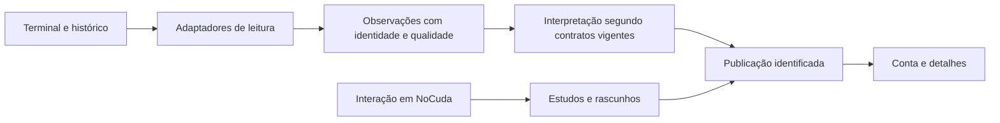

# 1. Arquitetura MQL5 aplicada ao Stoikus

## 1.1 O programa certo para cada responsabilidade

O primeiro problema de arquitetura em MQL5 é distribuir responsabilidades entre programas que possuem capacidades e ciclos de vida diferentes. Um indicador não é simplesmente um Expert Advisor com outra aparência, e um script não é um indicador que termina depressa. O terminal reconhece o tipo a partir do módulo compilado, seus tratadores e suas diretivas. A organização das pastas ajuda a encontrá-los, mas mover um arquivo de diretório não transforma sua natureza. Esse detalhe evita uma interpretação enganosa: colocar um utilitário em `Experts` não lhe dá automaticamente o contrato de execução de um EA. [TRD, sec. 5.1.1, p.PDF 613–615]

No Stoikus, essa distinção corresponde a uma divisão observável. O Monitor é o EA que mantém a observação da conta e a contabilidade; Conta e NoCuda são indicadores que apresentam informações e estudos; Abrir Painéis é um script para uma ação pontual. O Supervisor continua separado, opcional e sujeito ao próprio contrato. A capacidade de um EA receber eventos de negociação não implica que ele envie ordens: o Monitor não negocia. Essa responsabilidade está documentada em `mt5/jpw-alavancagem-atual/README.md`, nas seções de uso diário e componentes, e é compatível com o desenho de seus callbacks em `MQL5/Experts/JPWealth/JPW_Stoikus_Monitor.mq5`, sob essa mesma pasta.

O gráfico de apoio é parte dessa arquitetura. Só pode haver um EA por gráfico; anexar outro substitui o anterior. Vários indicadores podem coexistir. Portanto, separar o Monitor dos gráficos de trabalho protege a continuidade da observação contra a substituição acidental por outro EA. Fechar o painel de um indicador, fechar seu gráfico e fechar o gráfico do Monitor têm consequências diferentes. A primeira ação pode afetar apenas apresentação; a última interrompe o produtor. A documentação deve ensinar essa diferença antes de discutir classes ou padrões de projeto. [TRD, sec. 5.1, p.PDF 613; REF, Program Running, p.PDF 1046]

Um serviço poderia executar uma atividade sem estar associado a gráfico, mas a troca não seria uma refatoração cosmética. Serviços usam `OnStart`, possuem regras próprias de restauração e não recebem a coleção de eventos dos EAs. O manual não propõe converter o Monitor em serviço. O exemplo é útil para mostrar que escolher outro tipo de programa obriga a redesenhar o contrato de trabalho, cancelamento, comunicação e observabilidade. [REF, Program Running, p.PDF 1045–1047]

## 1.2 Fonte, unidade compilada e dependências

MQL5 monta uma unidade de compilação a partir de um arquivo principal `.mq5` e dos arquivos incluídos. A diretiva `#include` incorpora texto ao ponto em que aparece. Com colchetes angulares, a busca parte de `MQL5/Include`; com aspas, parte do diretório do arquivo que contém a diretiva. Um `.mqh` pode conter tipos, funções e estado; sua extensão não significa isolamento de processo, armazenamento compartilhado ou carregamento independente. Alterar um cabeçalho exige recompilar seus consumidores para que os executáveis incorporem a mudança. [TRD, sec. 2.9.1, p.PDF 154]

Essa organização permite que o mesmo cálculo seja usado por diferentes programas sem criar fórmulas paralelas. Entretanto, duas compilações do mesmo cabeçalho produzem dois contextos em memória, pertencentes aos respectivos programas. Uma variável global incluída no Monitor não se torna visível no indicador Conta por possuir o mesmo nome. Para comunicar programas, é necessário um mecanismo explícito: arquivo, banco, variável global do terminal, recurso ou evento apropriado. Confundir inclusão com comunicação cria sintomas difíceis de diagnosticar: o produtor altera seu valor e o consumidor continua lendo sua própria cópia.

Há ainda uma diferença entre código incluído e propriedades do programa. A descrição do livro observa que as diretivas `#property` têm efeito no módulo principal compilado, enquanto funções incluídas participam da identificação dos tratadores. Por isso, separar um callback para um cabeçalho requer controlar duplicações e o conjunto de eventos que chega ao programa final. Uma biblioteca que introduz silenciosamente `OnStart` ou `OnCalculate` pode alterar a interpretação da unidade; um cabeçalho de domínio não deveria surpreender seu consumidor dessa maneira. [TRD, sec. 5.1.1, p.PDF 614–615]

No candidato consultado, o arquivo principal do Monitor inclui os runtimes do observador e do contador, além de núcleo, estado e log. Essa composição é uma pista verificável de suas responsabilidades, não prova isolada de execução correta. A revisão precisa acompanhar as chamadas e seus efeitos. Para distribuir um pacote coerente, também é insuficiente copiar só o `.mq5`: o cabeçalho de versão, dependências e recursos devem pertencer ao conjunto identificado. O README atual distingue produto 1.23.0, MQL 1.230 e cálculo 1.9.0; uma mudança de apresentação não autoriza presumir mudança de fórmula.

## 1.3 Separar decisão, ambiente e apresentação

Uma decomposição útil começa pelas razões pelas quais uma parte pode mudar. Uma regra de interpretação de dados muda por revisão de contrato; a coleta muda por características do terminal; uma janela muda por interação e espaço disponível; a persistência muda por integridade e compatibilidade. Misturadas em uma função longa, essas razões se tornam dependências ocultas. Uma correção de clique acaba alterando a consulta contábil, e uma otimização de leitura pode modificar a qualidade exibida sem revisão consciente.

O princípio de abstração tratado no livro oferece uma orientação prática: definir uma interface pelo que o consumidor precisa saber e manter a implementação substituível dentro desse contrato. Encapsulação protege o estado que sustenta a interface. Isso não exige transformar cada função em classe. Uma função pequena com entradas explícitas e saída bem definida pode fornecer uma fronteira mais clara que uma hierarquia extensa de objetos. Classes são úteis quando há estado e operações cujo vínculo precisa permanecer consistente. [TRD, sec. 3.2.1–3.2.2, p.PDF 180–182]

Para o Stoikus, convém distinguir três perguntas. O que foi observado na conta? O que pode ser calculado a partir dessa observação e dos contratos aplicáveis? Como comunicar o resultado, sua unidade e seus limites ao usuário? A resposta à primeira não autoriza automaticamente a segunda, e uma apresentação elegante não resolve uma falta de cobertura. Um valor numérico só é uma resposta completa quando preserva identidade, origem, período, qualidade e motivo de indisponibilidade quando pertinente. Esta é uma síntese de engenharia aplicada; não acrescenta limite financeiro ao Estatuto.



O diagrama é uma decomposição explicativa, não um inventário literal de classes existentes. Ele torna explícito que a apresentação consome resultados com proveniência; não inventa o resultado ausente. Também distingue um estudo técnico de uma observação da corretora. Ambos podem aparecer na mesma interface sem adquirir a mesma origem ou autoridade.

## 1.4 Memória tem proprietário e duração

O escopo de uma variável e sua duração são escolhas arquiteturais. Uma variável local existe durante sua região de execução; uma global pertence ao contexto do programa; uma estática local conserva estado entre chamadas sem expô-lo globalmente. O livro recomenda restringir a visibilidade ao menor contexto que precisa do valor, reduzindo alterações acidentais e usos incompatíveis. Esse princípio é especialmente importante em callbacks: um cursor de auditoria pode precisar sobreviver ao retorno do timer, enquanto um valor temporário da leitura de uma posição não precisa. [TRD, sec. 2.3.2 e 2.3.4, p.PDF 66–67 e 74–75]

Conservar estado exige conhecer os reinícios. Para EAs, mudar símbolo, período ou entradas pode chamar `OnDeinit` e `OnInit` sem descarregar toda a unidade e reinicializar globais e estáticas. Um desenvolvedor que supõe começar do zero pode reaproveitar identidade, cursor ou handle da fase anterior. O contrato de reinicialização deve dizer quais campos são descartados, quais são preservados e sob quais verificações podem ser reutilizados. Isso é diferente de persistência em disco e diferente de uma variável global do terminal. [TRD, sec. 5.1.4, p.PDF 625; REF, Program Running, p.PDF 1046]

Há uma consequência para o projeto de APIs internas. Passar uma estrutura por referência permite alterar o estado do chamador; passá-la como referência constante expressa leitura e impede aquela alteração pela interface. O símbolo `&` não documenta sozinho a intenção: a combinação com `const`, nomes e contrato precisa esclarecer se a função consulta, preenche ou transforma. Para uma fotografia de conta usada por vários cálculos, preservar a entrada facilita comparar resultados e detectar qual etapa introduziu uma divergência. [TRD, sec. 2.8.4, p.PDF 141–143]

Um exemplo sintético de fronteira evita misturar indisponibilidade com valor zero:

```mql5
struct Reading
  {
   bool available;
   double value;
   string reason;
  };

bool TryDifference(const Reading &a,const Reading &b,double &out)
  {
   if(!a.available || !b.available) return(false);
   if(!MathIsValidNumber(a.value) || !MathIsValidNumber(b.value))
      return(false);
   double candidate=a.value-b.value;
   if(!MathIsValidNumber(candidate)) return(false);
   out=candidate;
   return(true);
  }
```

O trecho é original e didático, sem compilação nativa nesta pesquisa. Não implementa uma fórmula financeira do Stoikus. O sucesso exige disponibilidade, entradas finitas e diferença finita; a saída permanece sem alteração na falha. Duas entradas finitas ainda podem produzir uma diferença fora da faixa representável, motivo para conferir também o candidato antes da atribuição. `MathIsValidNumber` rejeita NaN e infinitos conforme a referência. [REF, MathIsValidNumber, p.PDF 1986] O consumidor deve respeitar o retorno; imprimir a variável após uma falha reintroduziria justamente o erro que a interface procurou evitar. Um teste útil começa com um valor anterior em `out`, provoca indisponibilidade, entrada não finita ou overflow da diferença e verifica se o chamador não publica esse resíduo. Finitude não comprova compatibilidade de unidade, conta ou instante: essas condições continuam pertencendo ao contrato do chamador.

## 1.5 Composição e autoridade de recursos

Herança modela uma relação em que o derivado pode atuar como o tipo base; composição modela a presença de partes em um todo. A distinção ajuda a evitar árvores artificiais. Um controlador de janela possui elementos de interface, mas não é necessariamente uma forma especial de banco de dados. Um monitor usa um contador, mas isso não significa que seja uma subclasse dele. O livro distingue ainda composição, na qual o proprietário controla a vida das partes, de agregação, na qual referências podem apontar a partes que existem independentemente. [TRD, sec. 3.2.3–3.2.5, p.PDF 182–183]

No terminal, propriedade não é apenas um assunto de memória. Um programa pode adquirir um arquivo, um handle de indicador, uma conexão de banco ou um conjunto de objetos gráficos. A pergunta decisiva é qual instância tem autoridade para liberá-los. Uma tentativa de inicialização que falhou antes da aquisição não deve executar a mesma limpeza de uma instância plenamente ativa se isso atingir recursos de outra instância. O capítulo de eventos aprofunda a sobreposição de inicialização e saída dos indicadores; aqui importa reconhecer a propriedade como parte da interface de cada componente.

O código do Monitor confirma que identidade e titularidade acompanham a execução. Antes de continuar o trabalho no timer, ele relê a identidade, verifica a propriedade e interrompe a atividade quando a lease muda. Essa leitura de fonte sustenta a descrição de intenção e fluxo. Ela não comprova a eficácia do mecanismo em todos os intercalamentos do terminal; essa conclusão depende dos testes adequados. Referência de implementação: `mt5/jpw-alavancagem-atual/MQL5/Experts/JPWealth/JPW_Stoikus_Monitor.mq5`, `OnTimer` e `JPWMonitorAttach`.

## 1.6 Uma arquitetura verificável preserva diferenças

O último critério arquitetural é a possibilidade de produzir evidência sobre cada fronteira. Uma função independente do terminal pode receber fixtures e permitir comparação determinística. Um adaptador exige demonstrar o significado e a disponibilidade dos dados nativos. Uma publicação exige verificar compatibilidade e integridade. Uma interface exige interação no ambiente que entrega seus eventos. Nenhuma dessas provas substitui automaticamente as outras.

No candidato atual, o README identifica compilação e interação nativas, instalação demo, aceite humano e Windows x64 independente como `NOT_RUN`. Esse estado convive com verificações host históricas e documentação extensa. A arquitetura deve permitir localizar o que já foi demonstrado sem transformar a soma de evidências parciais em uma certificação inexistente. Um pacote de fontes consistente é uma entrega; um EX5 compilado com recibo dos mesmos bytes é outra; execução observada e aceite são etapas adicionais.

O exercício de leitura recomendado é seguir uma única informação do terminal até o detalhe exibido. Anote onde nasce, como se identifica sua conta, quais condições a tornam utilizável, quem a conserva e qual evento provoca nova leitura. Em seguida, acompanhe a mesma informação durante desconexão, troca de conta e remoção do produtor. Se uma dessas perguntas não tiver resposta no contrato ou na evidência, registre a lacuna. Não a complete com a aparência da tela ou com uma regra financeira presumida. Esse método transforma o mapa de componentes em compreensão operacional e prepara os capítulos de eventos, persistência e testes.

Considere, por exemplo, uma leitura fictícia que estava disponível antes de fechar o gráfico de apoio. O indicador ainda pode possuir em memória a última publicação, mas a arquitetura precisa explicar se ela é uma fotografia histórica, uma leitura desatualizada ou informação ainda utilizável segundo o contrato vigente. A resposta não deve depender apenas de o número continuar desenhado. É necessário acompanhar a evidência de presença do produtor e a validade da publicação. Reabrir o gráfico inicia uma nova fase de observação; não comprova retrospectivamente o intervalo sem coleta.

Esse percurso também ajuda a delimitar uma mudança futura. Se o problema estiver na comunicação de indisponibilidade, a investigação pode concentrar-se no adaptador de apresentação e em seus consumidores. Se a publicação associa a conta errada, a fronteira afetada é outra e pode envolver dados persistidos. Descrever essa diferença antes de editar impede que uma tarefa de documentação ou aparência se transforme inadvertidamente em alteração de integridade.
