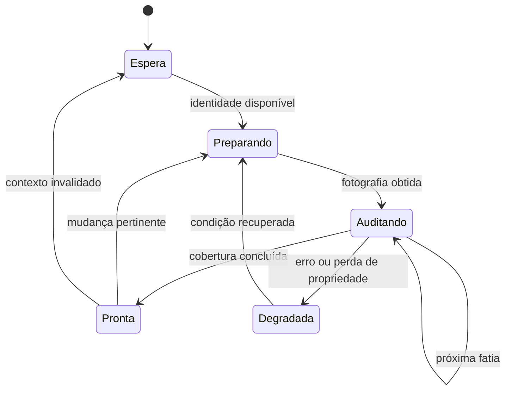

# 3. Eventos, ciclos de vida e trabalho cooperativo

## 3.1 O terminal chama; o programa devolve o controle

EAs e indicadores são programas conduzidos por eventos. O terminal chama um tratador com assinatura predefinida, o programa realiza uma parte do trabalho e retorna. Enquanto aquela função está em execução, outro tratador do mesmo programa não passa a executar em paralelo. O timer acrescenta oportunidades de trabalho, não uma segunda thread. EAs, scripts e serviços recebem suas próprias threads; indicadores do mesmo símbolo compartilham uma thread, inclusive quando estão em gráficos diferentes. Uma operação pesada no indicador pode, portanto, prejudicar outras leituras e a responsividade associada ao símbolo. [TRD, sec. 5.1.2–5.1.3, p.PDF 616–618; REF, Program Running, p.PDF 1042]

Essa combinação impõe duas disciplinas. O callback deve terminar em tempo compatível com os outros eventos, e o estado necessário para continuar depois precisa sobreviver fora de suas variáveis locais temporárias. Um laço que percorre todo o histórico em `OnTimer` não se torna cooperativo por estar dentro de um timer. Ele só devolve o controle quando termina. Um laço infinito em EA ou indicador pode impedir o restante de seu fluxo; `Sleep` não é uma ferramenta para criar concorrência e sequer é permitido em indicadores. [REF, Program Running, p.PDF 1044]

O termo assíncrono descreve a separação entre chegada e processamento, não acesso ilimitado e simultâneo ao próprio código. A fila permite que um evento espere enquanto outro é tratado. Seu tamanho é limitado, e certos eventos nem são adicionados se já houver outro equivalente pendente ou em processamento. O livro adverte contra escrever um desenho que dependa da recepção individual de todos os ticks e pulsos de timer. A coleção exata de otimizações de eventos pode evoluir; as garantias necessárias devem vir da documentação da família pertinente. [TRD, sec. 5.1.3, p.PDF 621–622]

## 3.2 Inicializar não significa possuir todos os dados

`int OnInit()` permite comunicar sucesso ou falha de preparação. O retorno zero indica sucesso; códigos da enumeração `ENUM_INIT_RETCODE` distinguem falha, entradas inválidas e agente inadequado para a otimização. Um retorno não nulo gera desinicialização com `REASON_INITFAILED`. A referência recomenda a forma com retorno, pois `void OnInit()` representa sucesso incondicional. Há um cuidado adicional: `INIT_FAILED` descarrega o EA, enquanto um indicador nessa situação permanece anexado, porém inoperante e sem novos tratadores chamados. [REF, OnInit, p.PDF 2082–2084]

O contrato de inicialização deve distinguir uma condição fatal de uma condição recuperável. Parâmetro estruturalmente inválido pode inviabilizar a execução; ausência transitória de conexão pode permitir que um observador aguarde. O livro destaca que `OnInit` frequentemente ocorre antes de o terminal conhecer propriedades completas da conta e dos instrumentos. Receber zero onde se esperava um valor não demonstra necessariamente um fato financeiro igual a zero. Se o funcionamento admite esperar, a preparação pode ser retomada em evento posterior com estado explícito. [TRD, sec. 5.1.5, p.PDF 626–627]

No Monitor consultado, `OnInit` limpa estado de agendamento e log, tenta obter identidade e anexar o núcleo, registra a espera quando não consegue fazê-lo e exige sucesso ao criar o timer de um segundo. A falha desse timer chama a separação do núcleo e retorna `INIT_FAILED`. A condição de espera por identidade segue caminho diferente. Essa distinção não é teórica: ela evita confundir programa carregado com publicação disponível. Fonte: `mt5/jpw-alavancagem-atual/MQL5/Experts/JPWealth/JPW_Stoikus_Monitor.mq5`, função `OnInit`.

Uma boa sequência de aquisição deve ser reversível. Se a etapa um adquiriu um arquivo e a etapa dois falhou ao preparar outra dependência, a limpeza precisa liberar a primeira aquisição sem alegar sucesso global. A mesma rotina de saída pode precisar suportar inicialização parcial. Para isso, handles começam em sentinelas inválidas e flags representam aquisições confirmadas; a mera execução de uma linha anterior não basta como prova de propriedade. Esse é um padrão de engenharia proposto para raciocínio e revisão, não uma afirmação de que todas as dependências atuais o implementam perfeitamente.

## 3.3 Reinicialização, encerramento e sobreposição de instâncias

`OnDeinit(const int reason)` informa por que o programa está saindo ou se reinicializando. Troca de gráfico, entradas, conta, template, recompilação e fechamento são motivos distintos. O motivo permite registrar a transição e escolher a limpeza adequada, mas não deve virar um atalho para apagar dados cujo proprietário e durabilidade não foram estabelecidos. Fechar uma janela de consulta não autoriza eliminar o histórico da conta. [REF, OnDeinit, p.PDF 2085–2086]

Em EAs, determinadas reinicializações preservam globais e estáticas. Assim, `OnInit` precisa reconstruir deliberadamente o estado da nova fase. Um flag de publicação atual ou um cursor de leitura da conta anterior não pode sobreviver apenas porque continua em memória. O desenho deve verificar identidade e geração, sobretudo em uma ferramenta que observa a conta inteira a partir de um gráfico de apoio. [TRD, sec. 5.1.4, p.PDF 624–625]

Indicadores apresentam outra dificuldade. Ao mudar símbolo ou período, a cópia nova pode ser inicializada antes de a anterior terminar sua saída. Se ambas usam os mesmos nomes de objetos, a cópia antiga pode apagar recursos que a nova acabou de criar. A fonte recomenda sincronização ou identificação suficientemente específica; simplesmente executar uma limpeza geral no fim não resolve a sobreposição. [TRD, sec. 5.1.5, p.PDF 628]

Essa observação ajuda a ler o contrato do NoCuda registrado no README do projeto: a instância só limpa recursos que adquiriu, e uma inicialização recusada não deve remover objetos pertencentes a outro indicador. A afirmação é sobre a documentação atual e seu objetivo; provar que cada intercalamento o respeita exige ensaio nativo. Casos úteis incluem anexar uma segunda instância recusada, trocar o período repetidamente e remover a primeira depois que a segunda já iniciou. O oráculo verifica quais objetos permanecem e a quem pertencem, em vez de aceitar apenas ausência de mensagem de erro.

## 3.4 Um timer é um convite, não um relógio de contabilização

`EventSetTimer(seconds)` solicita eventos periódicos e retorna sucesso ou falha. Cada EA ou indicador pode ter um único timer. `EventKillTimer()` o desativa; a saída do programa também o destrói. A referência é explícita: se um evento Timer já está na fila ou em execução, outro não é enfileirado. Um callback que dura mais que o período elimina a equivalência entre número de chamadas e tempo transcorrido. [REF, EventSetTimer, p.PDF 3189; REF, OnTimer, p.PDF 2098]

Imagine um timer de um segundo cujo trabalho demora 2,4 segundos. Não se deve esperar uma sequência posterior de chamadas que represente fielmente todos os segundos perdidos. Se um prazo real importa, o controlador compara marcas temporais pertinentes; se importa uma alteração de conta, relê o estado relevante. Um contador incrementado em cada callback mede chamadas recebidas. Só mede segundos quando essa equivalência tiver sido demonstrada nas condições pertinentes, o que o mecanismo não garante em geral.

Um único timer pode acionar tarefas lógicas em cadências diferentes. O livro apresenta essa composição sem criar timers nativos independentes para cada módulo. Contudo, um multiplicador de pulsos herda a perda de pulsos do timer base. Para uma atualização visual aproximada isso pode ser aceitável; para expiração de validade, é necessário comparar tempo e contexto. Reduzir o período não cura trabalho excessivo: aumenta a pressão e pode tornar testes muito mais demorados. O timer de milissegundos mantém as mesmas limitações de execução e apresenta resolução prática condicionada pelo hardware. [TRD, sec. 5.6.1–5.6.3, p.PDF 837–838 e 847–848]

No Stoikus atual, `OnTimer` verifica identidade e titularidade, prepara o observador, escolhe módulos e preserva oportunidade de publicação técnica. A implementação usa relógio monotônico e orçamento de execução; operações indivisíveis ainda podem ultrapassar uma fatia. Ler uma condição de orçamento antes de uma consulta SQL não prova que a consulta terminará dentro do orçamento. O README reconhece esse limite e mantém a latência MT5 sem comprovação nativa. Fonte: `mt5/jpw-alavancagem-atual/README.md`, continuidade 1.22.3; arquivo principal do Monitor, função `OnTimer`.

## 3.5 Transações sinalizam mudanças; reconciliação estabelece estado

`OnTradeTransaction` recebe descrição da transação, solicitação e resultado. Os dois últimos argumentos têm conteúdo pertinente à transação `TRADE_TRANSACTION_REQUEST`; usá-los indiscriminadamente para toda transação produz associações falsas. O evento também chega por operações manuais, ativações de ordens e ações do servidor. Recebê-lo não significa que o próprio EA iniciou uma negociação. [REF, OnTradeTransaction, p.PDF 2106]

Uma solicitação pode produzir vários eventos: criação de ordem, execução, retirada da lista ativa, entrada no histórico e alteração de posição. A prioridade de chegada das transações não é garantida. Além disso, o terminal continua processando mudanças da conta durante o callback. A ordem pode deixar de existir na lista ativa enquanto o programa ainda trata sua adição. A fila específica comporta 1.024 elementos; tratamento demorado pode fazer transações anteriores serem substituídas pelas novas. Não existe relação universal de um para um entre solicitações, `OnTrade` e `OnTradeTransaction`. [REF, OnTradeTransaction, p.PDF 2107]

Essas garantias favorecem callbacks curtos. Eles marcam trabalho pendente, preservam informações estritamente necessárias e permitem que um reconciliador consulte o estado e o histórico em condições controladas. Uma fila interna, se existir, também precisa de limite e política de perda explícitos; mudar a fila do terminal para um array não elimina o problema. A reconciliação deve ser idempotente: observar o mesmo fato de novo não cria um segundo registro financeiro equivalente.

No Monitor, o comentário e as chamadas do callback confirmam a intenção de apenas sinalizar: ele verifica titularidade e identidade, marca contexto sujo se necessário e encaminha a transação aos runtimes. Não faz seleção histórica, persistência ou notificação nesse trecho principal. Essa propriedade reduz a quantidade de trabalho na fronteira mais sensível, mas precisa ser acompanhada nas funções chamadas para sustentar conclusões mais amplas. Fonte: `mt5/jpw-alavancagem-atual/MQL5/Experts/JPWealth/JPW_Stoikus_Monitor.mq5`, `OnTradeTransaction`.

## 3.6 Máquina de estados para uma leitura incremental

A forma mais simples de raciocinar sobre trabalho cooperativo é tornar sua fase explícita. Uma auditoria pode estar aguardando identidade, preparando uma fotografia, percorrendo registros, pronta ou degradada. Cada evento realiza uma transição permitida. O usuário não deve receber uma leitura confirmada enquanto o percurso ainda está em andamento, nem conservar a confirmação da fotografia anterior quando a identidade mudou.



O diagrama é uma proposta didática de estados, não uma nova enumeração canônica do produto. Ele mostra uma propriedade importante: recuperação significa voltar a demonstrar as condições de prontidão. Não significa apenas esconder o aviso anterior. Se uma segunda conexão alterou a base, um cursor no final do arquivo não comprova a fotografia atual. Se houve troca de conta, conservar a mesma quantidade de linhas não valida a identidade.

Um exemplo sintético torna a continuação observável sem depender do mercado:

```mql5
int cursor=0;
bool complete=false;

void ProcessSlice(const int total,const int allowance)
  {
   int processed=0;
   while(cursor<total && processed<allowance)
     {
      // Aqui entraria uma transformação determinística de um item.
      cursor++;
      processed++;
     }
   complete=(cursor==total);
  }
```

O exemplo é original, sem compilação nativa nesta pesquisa. O limite por quantidade facilita testar a progressão, mas não garante duração: um item pode custar muito mais que outro. Uma implementação real pode combinar quantidade, tempo e operações indivisíveis, documentando o que cada limite controla. O teste começa com dez itens e fatias de três: as chamadas devem terminar com cursores três, seis, nove e dez. Após a última, repetir a chamada não acrescenta processamento. Se a identidade mudar, um controlador externo deve invalidar a conclusão antes de publicar outra leitura.

## 3.7 Scripts e indicadores na operação diária

Scripts e serviços possuem `OnStart` como entrada principal e não recebem o conjunto de callbacks assíncronos de EAs e indicadores. O script termina após sua ação e não é restaurado como atividade permanente ao reiniciar o terminal. As diretivas de confirmação e exibição de entradas controlam seu diálogo inicial; a existência de inputs sozinha não garante que esse diálogo apareça. [TRD, sec. 5.2–5.2.1, p.PDF 631–632]

Isso explica por que Abrir Painéis é um utilitário adequado para anexar os indicadores ausentes sem se tornar o produtor contínuo. Seu término é normal. O Monitor precisa permanecer no gráfico de apoio para manter acompanhamento; os indicadores continuam sujeitos aos eventos e ao estado de publicação. O leitor deve identificar o tipo antes de interpretar a ausência de uma janela: um script de teste que escreve no Experts pode ter cumprido seu papel sem deixar painel algum.

Também é necessário distinguir indicador anexado de indicador dependente criado por outro programa. O livro registra uma limitação arquitetural: indicadores dependentes criados por `iCustom` ou `IndicatorCreate` não recebem seu timer da mesma maneira que uma instância anexada. Um experimento que usa um EA para criar o indicador não substitui automaticamente o teste da instalação real do painel. [TRD, sec. 5.6.2, p.PDF 838]

Para revisar o ciclo completo, acompanhe uma inicialização incompleta, uma recuperação, uma atualização normal e uma saída. Em cada ponto, verifique o que o programa possui, o que pode publicar e o que comunica. Essa sequência revela defeitos que uma captura estática da interface não revela: rascunho perdido na minimização, confirmação antiga depois da troca de conta, limpeza de recurso alheio e mensagem repetida a cada pulso. A investigação pode começar com fontes e fixtures, mas o recebimento real dos eventos continua uma questão de ensaio nativo separado.
