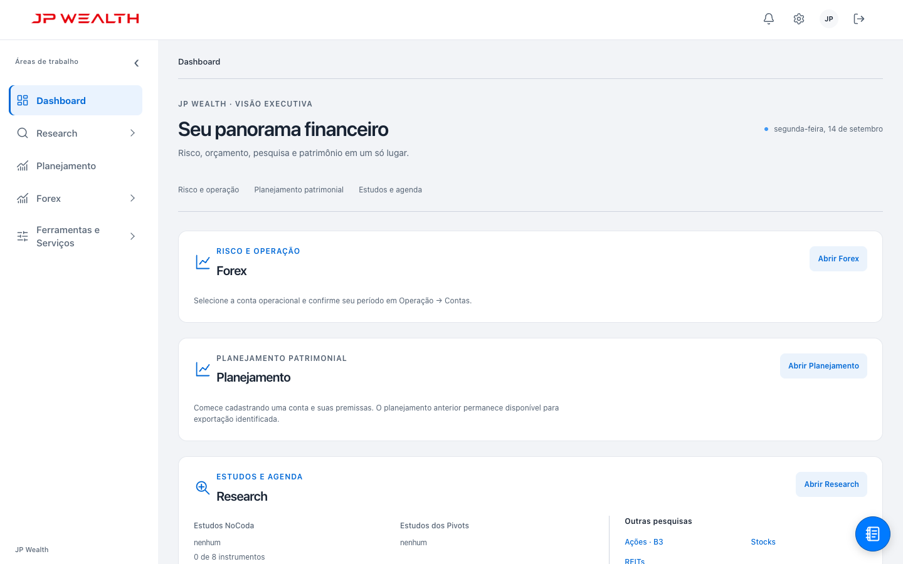
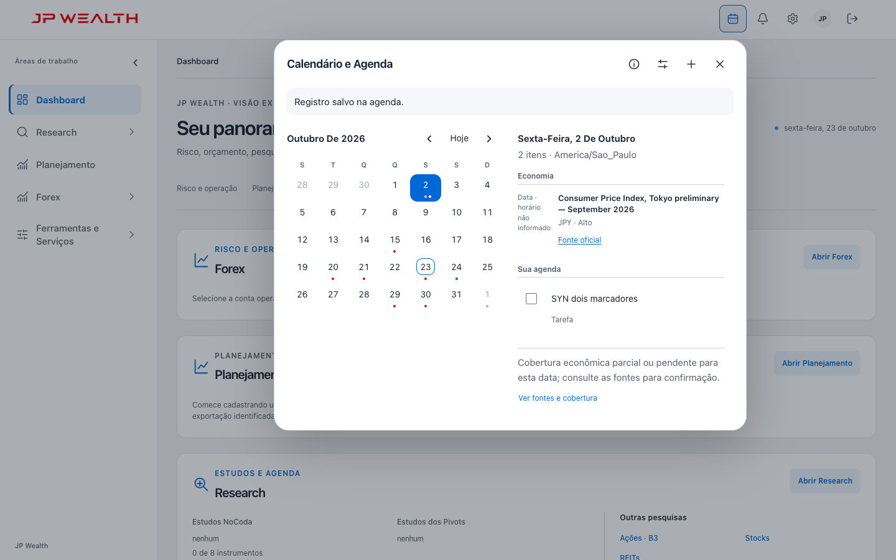
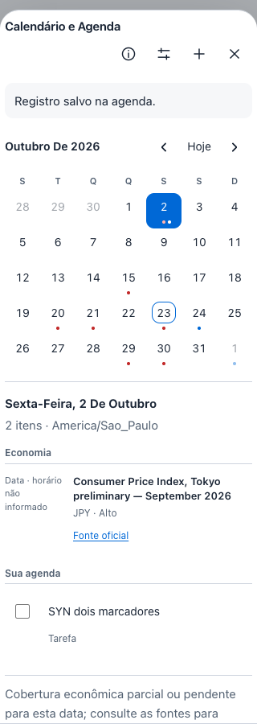

# Capturas antes e depois

Capturas com dados sintéticos e pacote econômico local, sem dados pessoais reais. O teste visual humano permanece separado da imagem automatizada.

| Desktop antes | Desktop depois |
|---|---|
|  |  |

| Celular antes | Celular depois |
|---|---|
|  |  |

Tema escuro: [desktop](after-1440-dark.png) e [celular](after-320-dark.png). As capturas posteriores correspondem ao build `85ae832b1f542745`, teste calendar-agenda PASS da rodada FULL6; a situação dos demais checks está no relatório final.
