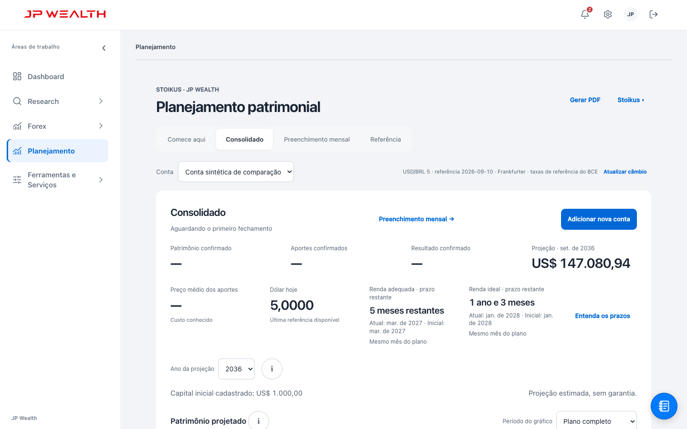
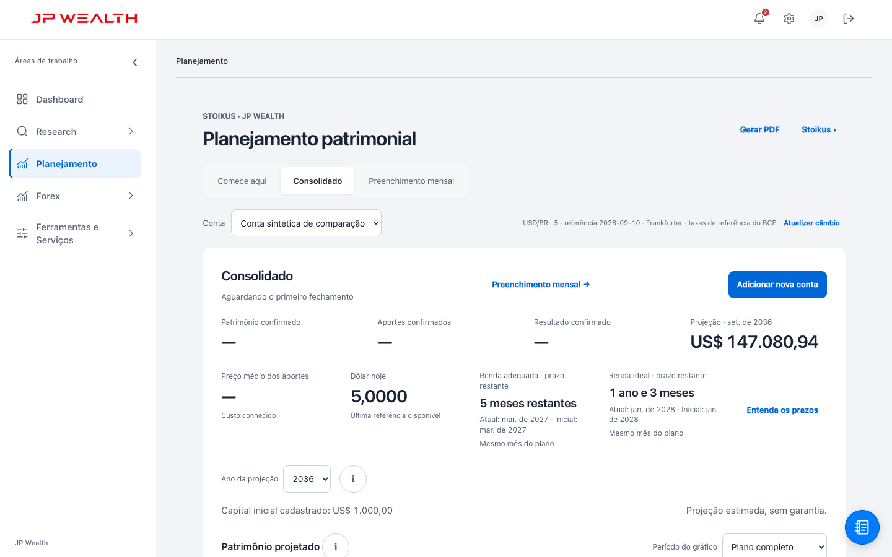
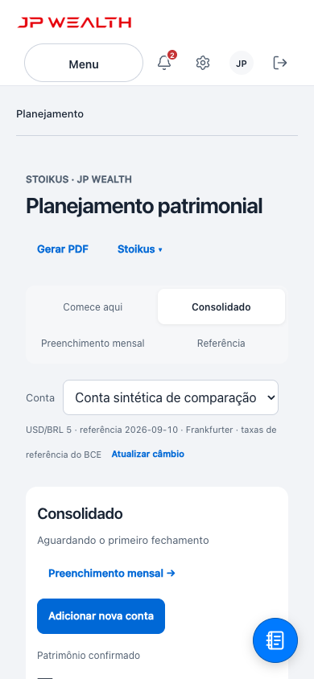
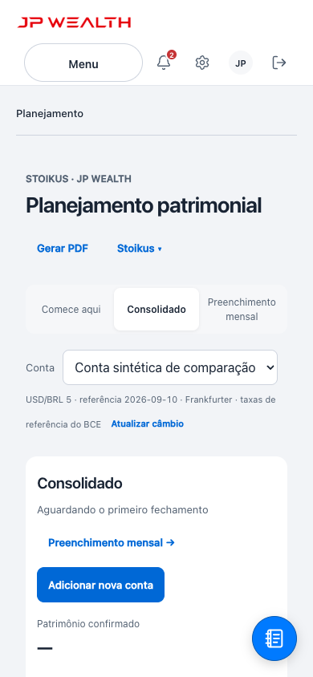
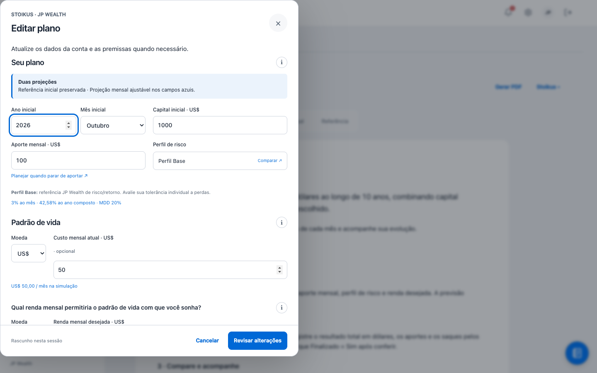
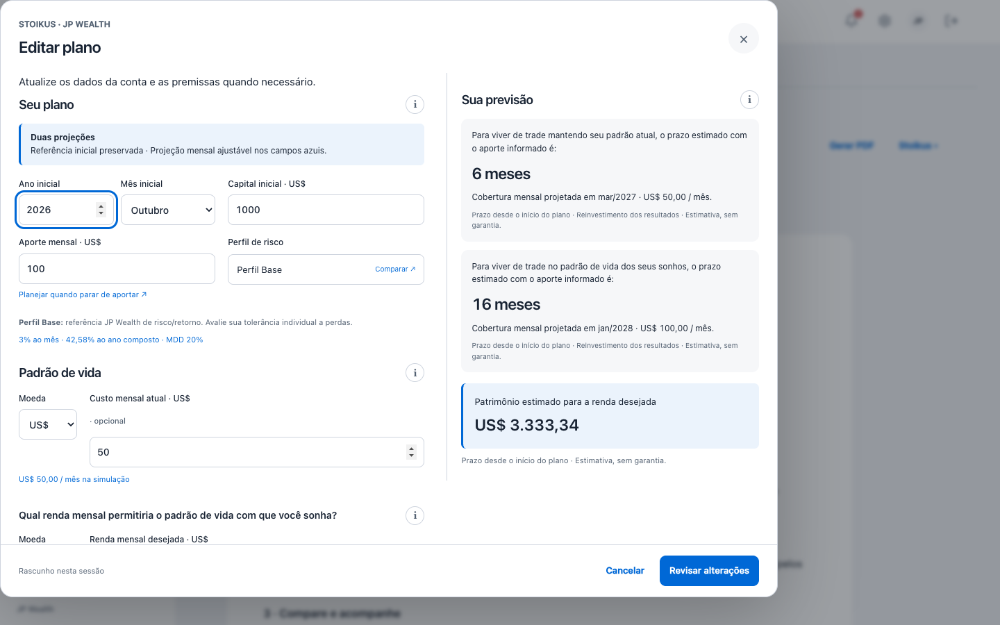
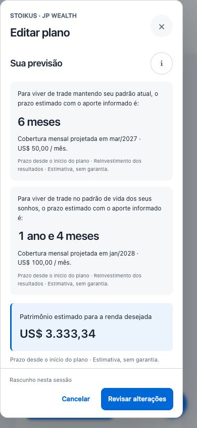
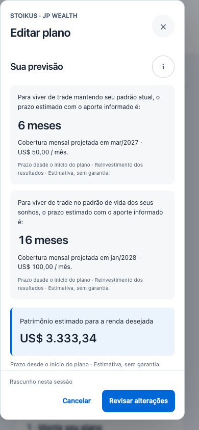

# Comparação visual real —443c →09d53

Foram capturados os dois produtos executáveis em Chromium, com a mesma conta sintética: início **outubro/2026**, capital **USD1.000**, aporte **USD100/mês**, **Base**, custo atual **USD50/mês** e renda desejada **USD100/mês**. As oito imagens abaixo são capturas integrais da viewport, sem montagem, recorte, CSS injetado ou alteração das perguntas.

O lado **Antes** vem da baseline completa `443c1a59f2c1f46d`, extraída de `candidate-443c-before.tar.gz`; os **1.629 arquivos regulares** coincidem com `baseline.json`. Os oito links do arquivo foram ignorados, sem segui-los. O lado **Depois** usa os arquivos congelados atuais do build `09d53f0be43dce10`, servidos diretamente da raiz do projeto em leitura.

## Abas e navegação —1440×900

| Antes —443c | Depois —09d53 |
|---|---|
|  |  |

Nas duas capturas, Consolidado está no topo com a mesma conta individual selecionada. O443c expõe **Comece aqui, Consolidado, Preenchimento mensal e Referência**; o09d53 expõe somente as **três páginas atuais**. A ordem desktop do menu também mostra Planejamento passando para depois de Research e antes de Forex. Os indicadores atuais, a fonte/data cambial e Gerar PDF/Stoikus permanecem visíveis.

Isso compara duas versões locais do site. As quatro abas do443c não são apresentadas como metadado atual da planilha Google.

## Abas —390×844

| Antes —443c | Depois —09d53 |
|---|---|
|  |  |

O enquadramento mantém o topo da página nas duas versões. No443c há quatro opções em duas linhas. No09d53 as três opções ocupam uma faixa; “Preenchimento mensal” continua inteiro em duas linhas dentro de seu botão. O conteúdo seguinte começa mais acima porque a navegação ocupa menos altura. O menu lateral fica recolhido nessa largura; esta imagem não demonstra sua ordem interna.

## Abertura real do formulário —1440×900

| Antes —443c | Depois —09d53 |
|---|---|
|  |  |

O formulário foi aberto pelo botão **Preencher o formulário** de Comece aqui. A conta única abre edição, com os mesmos valores sintéticos já preenchidos. Ambas as capturas têm rolagem interna **zero** e foco no ano inicial. O09d53 usa mais largura e já apresenta, ao lado das perguntas, os dois prazos: **6 meses —março/2027** e **16 meses —janeiro/2028**. No443c a previsão está mais abaixo, fora desta viewport de abertura; ela existe e calcula, como mostra a captura móvel seguinte. A ausência neste enquadramento não significa ausência de cálculo.

A largura dos diálogos é uma diferença real do produto. Não foi artificialmente igualada para a comparação.

## Previsão no celular —390×844

| Antes —443c | Depois —09d53 |
|---|---|
|  |  |

**Enquadramentos e caminhos distintos, declarados:** no443c foi necessário rolar até o bloco, pois não há botão de salto; a automação usou a rolagem do elemento, sem alterar seu estilo. No09d53 foi acionado o botão real **Ver sua previsão**, que levou foco ao bloco e rolou a área de leitura. A imagem final aguardou a rolagem concluir. As posições internas registradas são1076px e1136px, respectivamente; não são um teste de alinhamento pixel a pixel.

Os dois lados mostram **6 meses —março/2027**, **janeiro/2028** para o segundo objetivo e patrimônio estimado de **USD3.333,34**. O443c expressa o segundo prazo como **1 ano e4 meses**; o09d53 como **16 meses**. São a mesma duração e data. A inspeção visual das oito imagens confirmou conteúdo legível nos enquadramentos capturados, sem corte horizontal dos prazos.

## Proveniência, integridade e limites

- Cada lado foi aberto por HTTP local próprio, em contexto descartável, sem perfil pessoal. A conta foi criada pela API de comandos somente como preparação sintética; navegação, abertura e salto usaram os controles reais. O snapshot financeiro permaneceu idêntico durante as capturas do formulário/navegação.
- A taxa USD/BRL5 e sua data2026-09-10 são **fixture de rede**, não consulta cambial atual. Os objetivos desta comparação foram informados em USD e não dependem dessa taxa. As fontes do app foram carregadas integralmente de cada raiz; nenhuma resposta de fonte/código/estilo foi substituída.
- O recibo [SCREENSHOT-COMPARISON-RECEIPT.json](SCREENSHOT-COMPARISON-RECEIPT.json) contém origens, hashes das oito PNGs, build observado no navegador, viewport, abas, foco, caixas e rolagem. O tar original e helpers ficam na área ignorada `.superpowers/sdd/planning-three-tabs-20261020/`. A primeira imagem móvel09d53, capturada durante a rolagem, foi preservada ali como frame anterior; não é a imagem final acima.
- Os **327 inputs do fingerprint**, **397 recursos runtime**, **259 testes** e **runner** foram conferidos antes/depois e permaneceram byte a byte iguais aos recibos congelados. As novas imagens, este texto e o recibo visual estão fora desses inputs. Não houve rebuild, execução de suíte geral nem mudança de produto/testes/CHG/Git nesta etapa.
- Comparação restrita ao layout padrão, tema claro, Chromium e às duas larguras/alturas indicadas. Não demonstra Safari, leitor de tela, toque físico, execução autenticada do Apps Script ou comportamento universal. Os produtos são identificáveis; não houve cegamento integral. Inspeção visual do agente não substitui compreensão nem aceite humano, e estas capturas não substituem o resultado do FULL.
